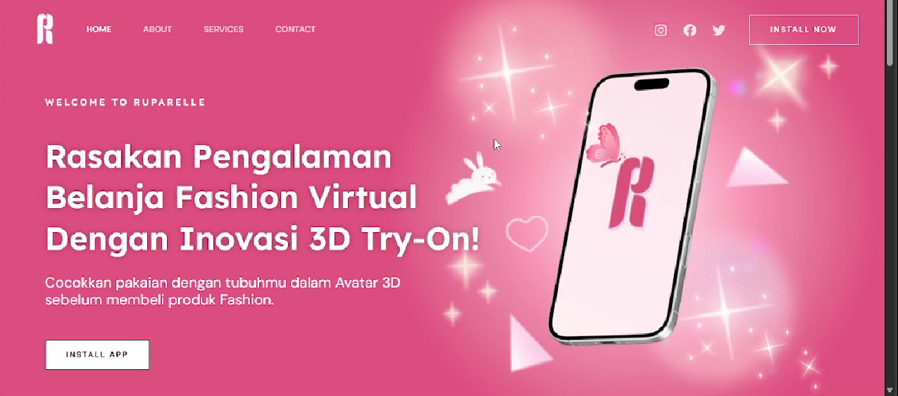

# Ruparelle — Fashion E-Commerce Website

## About the Project

Ruparelle is a collaborative team project focused on developing a fashion e-commerce website using WordPress, the Astra theme, and Elementor.

The project explores website layout customization, fashion product presentation, and user-friendly navigation to create an engaging online shopping experience.

## Tools & Technologies

- WordPress
- Astra Theme
- Elementor Page Builder

## Project Highlights

- Fashion website layout and page design
- Product presentation and website navigation
- Website customization using WordPress tools
- Collaboration and coordination during project development

## Team Project

Ruparelle was developed collaboratively as part of a team project.

**My Contribution:** To be specified based on my actual responsibilities in the project.

## What I Learned

- WordPress website development and customization
- Website layout and user experience considerations
- Collaboration and communication in a team project

## Project Screenshots

---

*This repository serves as portfolio documentation for a collaborative project.*
